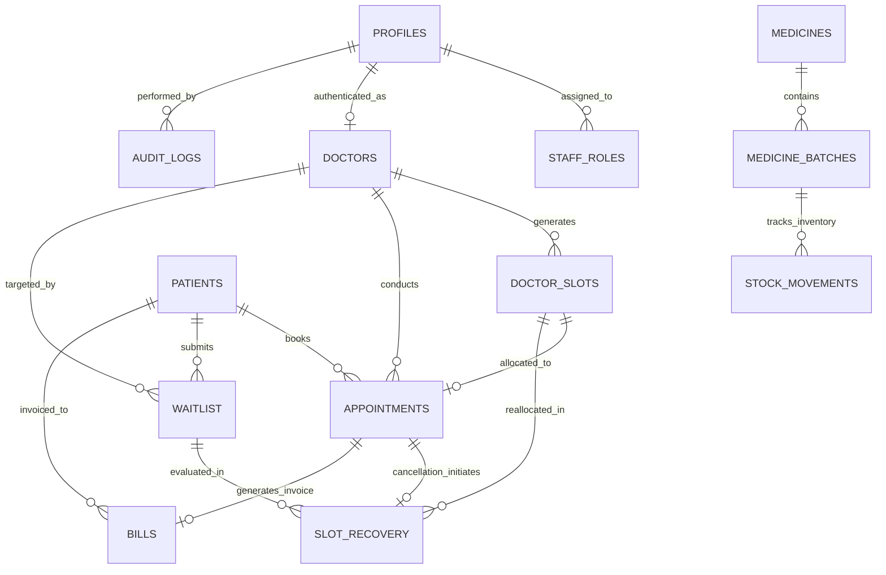

# CareBridge 360 — Entity Relationship (ER) Diagram & Schema Specifications
**Course:** BCSE302L Database Systems  
**Project:** Digital Assignment II (DA2)  
**System:** CareBridge 360 — Explainable Database-Driven Hospital Appointment and Resource Optimization System  

---

## 1. Complete Entity-Relationship (ER) Diagram (Mermaid)

---

## 2. Relational Cardinalities & Multiplicities

| Parent Entity | Child Entity | Relationship Name | Cardinality | Enforcing Mechanism |
| :--- | :--- | :--- | :--- | :--- |
| **`profiles`** | **`staff_roles`** | Assigned RBAC roles | $1 : N$ | Foreign Key `user_id` with `ON DELETE CASCADE` |
| **`profiles`** | **`doctors`** | Doctor login link | $1 : 1$ (Optional) | Foreign Key `profile_id` with `ON DELETE SET NULL` |
| **`doctors`** | **`doctor_slots`** | Consultation time blocks | $1 : N$ | Foreign Key `doctor_id` + Composite Unique Constraint `(doctor_id, slot_date, start_time)` |
| **`doctors`** | **`appointments`** | Clinic appointments conducted | $1 : N$ | Foreign Key `doctor_id` with `ON DELETE RESTRICT` |
| **`patients`** | **`appointments`** | Patient bookings | $1 : N$ | Foreign Key `patient_id` with `ON DELETE RESTRICT` |
| **`doctor_slots`** | **`appointments`** | Slot allocation | $1 : 1$ (Unique) | Foreign Key `slot_id UNIQUE` on `appointments` |
| **`patients`** | **`waitlist`** | Waitlist entries | $1 : N$ | Foreign Key `patient_id` with `ON DELETE CASCADE` |
| **`appointments`** | **`slot_recovery`** | Slot recovery trigger | $1 : 1$ | Foreign Key `cancelled_appointment_id` + Trigger `trg_appointment_status_sync` |
| **`appointments`** | **`bills`** | Consultation billing | $1 : 1$ (Unique) | Foreign Key `appointment_id UNIQUE` on `bills` |
| **`medicines`** | **`medicine_batches`** | Drug batch inventory | $1 : N$ | Foreign Key `medicine_id` + Composite Unique `(medicine_id, batch_number)` |
| **`medicine_batches`** | **`stock_movements`** | Inventory ledger | $1 : N$ | Foreign Key `batch_id` with `ON DELETE CASCADE` |
| **`profiles`** | **`audit_logs`** | Security audit trail | $1 : N$ | Foreign Key `user_id` with `ON DELETE SET NULL` |

---

## 3. Database Integrity Invariants & Constraints Summary

1. **Anti-Double Booking Invariant**:
   - `doctor_slots.UNIQUE(doctor_id, slot_date, start_time)` prevents overlapping consultation slots for the same physician.
   - `appointments.slot_id UNIQUE` ensures no two appointments can claim the same slot record.
2. **Anti-Negative Stock Invariant**:
   - `medicine_batches.CHECK(current_stock >= 0)` ensures inventory can never drop below zero.
3. **Anti-Duplicate Invoicing Invariant**:
   - `bills.appointment_id UNIQUE` ensures exactly one bill per consultation.
4. **Time Sanity Check**:
   - `doctor_slots.CHECK(end_time > start_time)` and `waitlist.CHECK(preferred_time_end > preferred_time_start)`.
   - `medicine_batches.CHECK(expiry_date > manufacture_date)`.
5. **Concurrency Race Guard**:
   - Stored procedure `confirm_slot_recovery()` uses `SELECT ... FOR UPDATE` row-level locks to block concurrent claims on recovering slots.
