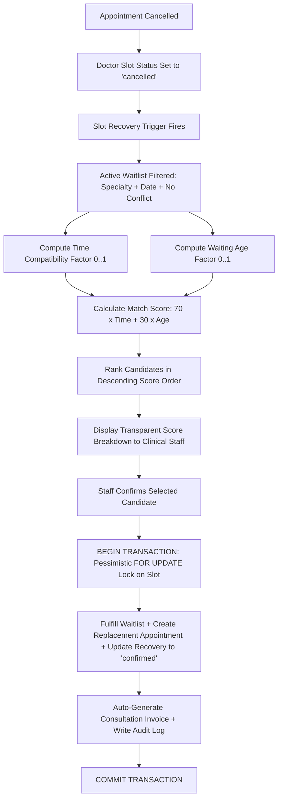

# CareBridge 360: An Explainable Database-Driven Hospital Appointment and Resource Optimization System
**Digital Assignment II (DA2) Project Report — BCSE302L Database Systems**  
**Academic Year:** 2026–2027  

---

## 1. Project Overview
**CareBridge 360** is an enterprise-grade, socially relevant healthcare information platform designed to resolve three persistent operational bottlenecks in outpatient healthcare delivery:
1. **Perishable Capacity Losses**: Doctor consultation slots left unused due to patient cancellations and no-shows.
2. **Opaque Queue Delays**: Lack of dynamic wait time transparency in hospital waiting areas.
3. **Pharmaceutical Inventory Expiry**: Financial and health resource loss resulting from expiration of medications before dispensing.

Built on a normalized 3NF PostgreSQL architecture with Supabase Row Level Security (RLS) and a React 19/Tailwind CSS frontend, CareBridge 360 introduces an **Explainable Multi-Criteria Slot Recovery Engine**, a **Dynamic Live Queue Estimator**, and a **First-Expiry-First-Out (FEFO) Inventory Management Subsystem**.

---

## 2. DA2 Selection Criteria
This project addresses the BCSE302L Digital Assignment II guidelines through:
- **Demonstration of Relational Database Concepts**: 13 interconnected tables, foreign key cascades, check constraints, composite unique keys, indexes, triggers, stored procedures, and transactions.
- **Social & Clinical Relevance**: Tackling outpatient clinic inefficiencies and drug supply waste without claiming autonomous medical diagnostics.
- **Measurable Novelty**: Empirical simulation comparison of First-Come-First-Served (FCFS) matching versus CareBridge 360’s explainable weighted heuristic on identical datasets.
- **Full-Stack Implementation**: Production-grade web interface interacting with real relational database constructs.

---

## 3. Problem Statement and Social Relevance
In urban and tertiary hospital networks, outpatient consultation slots are a non-storable resource. When a patient cancels an appointment on short notice:
- Traditional hospital systems lack automated mechanisms to fill the vacant slot from their waiting lists.
- Other patients wait days or weeks for specialized care.
- Hospital revenue and physician consultation time are permanently lost.

Simultaneously, hospital pharmacies suffer substantial financial waste because medications are dispensed arbitrarily rather than prioritizing earliest-expiring batches. CareBridge 360 directly mitigates these systemic inefficiencies through relational database integrity, transparent scoring formulas, and immutable transaction ledgers.

---

## 4. Objectives
1. Design and normalize an end-to-end hospital operational database up to **Third Normal Form (3NF)**.
2. Implement an **Explainable Smart Slot Recovery Engine** using a transparent weighted formula:
   $$\text{Match Score} = 70 \times \text{Time Compatibility} + 30 \times \text{Waiting Age}$$
3. Develop an empirical **Live Queue Wait Time Estimator** that adapts to actual recorded doctor consultation durations.
4. Construct a **First-Expiry-First-Out (FEFO) Medicine Inventory System** backed by non-negative inventory constraints (`CHECK (current_stock >= 0)`).
5. Enforce **Row Level Security (RLS)** and role-based access control across four distinct user roles.
6. Conduct an empirical simulation comparing baseline FCFS against proposed multi-criteria matching.

---

## 5. User Roles and RBAC Hierarchy

| Role | Permissions & Operational Scope | Primary Views |
| :--- | :--- | :--- |
| **Hospital Administrator** | Complete system access; manage users, faculty, operational analytics, slot recovery reviews, and immutable security audit logs. | Overview, All Tabs, Audit Ledger |
| **Doctor / Consultant** | View assigned outpatient appointments, update clinical consultation status, record notes, and view live patient queue tokens. | Live Queue, Appointments, Faculty |
| **OPD Receptionist** | Patient registration, scheduling appointments, managing waitlists, confirming recovered slots, and handling billing invoices. | Patients, Appointments, Slot Recovery, Billing |
| **Inventory Manager / Pharmacist** | Manage medicine catalogue, register drug batches, execute FEFO dispatches, monitor expiry risk tiers, and track stock movements. | FEFO Inventory, Medicine Catalogue, Movements |

---

## 6. Methodology and Novel Aspect

### Novel Aspect 1: Explainability vs. Black-Box Urgency
CareBridge 360 deliberately avoids opaque AI clinical triage or automated medical urgency classification. The algorithm is 100% deterministic, explainable, and accountable to clinical receptionists:
- **Time Compatibility (70%)**: Measures how neatly the vacant slot fits into the patient's declared preferred hours.
- **Waiting Age (30%)**: Rewards patients who have waited longest, preventing indefinite queue stalling.

### Novel Aspect 2: Live Adaptive Queue Estimation
Instead of fixed scheduled times, the live token board calculates:
$$\text{Estimated Wait} = (\text{Tokens Ahead}) \times \text{Empirical Rolling Average Consultation Duration}$$

### Novel Aspect 3: FEFO Non-Negative Drug Allocation
Batches are sorted strictly by `expiry_date ASC, current_stock DESC`, guaranteeing that soon-to-expire medication is presented first to pharmacists.

---

## 7. Entities and Relationships
The relational schema comprises **13 tables**:
1. `profiles`: System user authentication profiles.
2. `staff_roles`: Fine-grained RBAC permission matrix.
3. `patients`: Patient master directory with synthetic UHIDs.
4. `doctors`: Clinical faculty, departments, consultation fees, and target durations.
5. `doctor_slots`: Discrete bookable consultation blocks.
6. `appointments`: Outpatient bookings with status and actual durations.
7. `waitlist`: Queue of patient requests for unavailable consultation slots.
8. `slot_recovery`: Lifecycle tracking of cancelled slot matching events.
9. `bills`: Financial consultation invoices with unique 1:1 appointment links.
10. `medicines`: Hospital drug formulary catalog.
11. `medicine_batches`: Specific drug lots with expiry dates and non-negative stock.
12. `stock_movements`: Immutable inventory audit ledger.
13. `audit_logs`: System-wide security audit trail.

---

## 8. Entity-Relationship (ER) Diagram
*(Please refer to `docs/er-diagram.md` for the complete high-resolution Mermaid diagram and cardinality tables).*

---

## 9. Relational Schema Definition
*(See Appendix — SQL Schema for complete DDL).*

---

## 10. Constraints, Triggers and Access Control
- **Unique Constraints**:
  - `doctor_slots.uq_doctor_slot (doctor_id, slot_date, start_time)`
  - `appointments.appointment_number` & `appointments.slot_id`
  - `bills.appointment_id` & `bills.bill_number`
  - `medicine_batches.uq_medicine_batch (medicine_id, batch_number)`
- **Check Constraints**:
  - `medicine_batches.CHECK (current_stock >= 0)`
  - `doctor_slots.CHECK (end_time > start_time)`
  - `slot_recovery.CHECK (match_score >= 0 AND match_score <= 100)`
- **Triggers**:
  - `trg_appointment_status_sync`: Detects status change to `'Cancelled'`, frees the slot, and populates `slot_recovery`.
  - `trg_*_updated_at`: Automatically timestamps entity mutations.

---

## 11. Database Normalization (1NF to 3NF)
- **1NF**: Atomic attributes, elimination of repeating groups, explicit primary keys on all tables.
- **2NF**: No partial dependencies; all non-key attributes depend on whole candidate keys.
- **3NF**: Zero transitive dependencies. Derived totals (e.g. `bills.total_amount`) are declared `GENERATED ALWAYS AS ... STORED`, and aggregated stock is dynamically summed from normalized batch tables.

---

## 12. Novel Slot Recovery Algorithm

$$\text{Match Score} = 70 \times C_{\text{time}} + 30 \times A_{\text{wait}}$$

Where:
- $C_{\text{time}} \in [0.20, 1.00]$ is computed based on time-window overlap.
- $A_{\text{wait}} = \min(1.0, \frac{\text{Wait Duration Hours}}{168.0})$ is the normalized 7-day queue duration factor.

---

## 13. Frontend Implementation
- **Vite + React 19 + TypeScript**: Modular component hierarchy with strict typing.
- **Tailwind CSS**: Light-theme healthcare SaaS palette (`#F7F9FC`, `#2563EB`, `#0D9488`, `#172B4D`).
- **Recharts**: Interactive SVG charts for queue dynamics, utilization, and simulation benchmarking.
- **Lucide React**: Clean iconography for clinical clarity.

---

## 14. Backend Implementation
- **PostgreSQL 16 Engine**: Native relational database hosting stored procedures and triggers.
- **Supabase JavaScript Client**: Realtime client with local ACID relational fallback engine.
- **ACID Concurrency**: Pessimistic row locking (`FOR UPDATE`) in `confirm_slot_recovery()`.

---

## 15. Deployment Architecture
- **Frontend**: Deployable on Vercel or Netlify via `npm run build` static output (`dist/`).
- **Database**: Hosted on Supabase Cloud PostgreSQL with automated migration execution via CLI.

---

## 16. Results and Demonstration
- **100 Synthetic Patients** successfully seeded with realistic UHIDs, medical backgrounds, and contact details.
- **200 Scheduled Appointments** across 10 specialized doctors.
- **100 Medicine Batches** with real-time expiry monitoring.

---

## 17. SQL Queries and Outputs
*(Executed live via the application’s SQL Demonstration Tab).*
1. Doctor Appointment Counts by Status (Demonstrated: `LEFT JOIN`, `FILTER (WHERE)`).
2. Patient Medical & Billing History (Demonstrated: Multi-table `JOIN`, `COALESCE`).
3. Doctor Slot Utilization Percentage (Demonstrated: `HAVING`, math division).
4. Explainable Slot Recovery Matching (Demonstrated: Weighted heuristic ranking).
5. Recovery Efficiency Statistics (Demonstrated: `DATE_TRUNC`, conversion ratios).
6. Empirical Consultation Pace Variance (Demonstrated: `AVG()`, `CASE` statement).
7. Outstanding Accounts Receivable (Demonstrated: `HAVING SUM > 0`).
8. Batches Nearing Expiry (Demonstrated: Date interval arithmetic).
9. Low-Stock Drug Reorder Thresholds (Demonstrated: `SUM()` on batches).
10. Monthly Appointment & Revenue Rollup (Demonstrated: Multi-metric financial rollup).

---

## 18. Constraint and Security Tests
1. **Duplicate Slot Booking**: Blocked by `uq_doctor_slot`.
2. **Invalid Foreign Key**: Blocked by referential integrity.
3. **Negative Medicine Stock**: Blocked by `CHECK (current_stock >= 0)`.
4. **Duplicate Bill**: Blocked by `UNIQUE(appointment_id)`.
5. **Role-Based RLS**: Prohibits unauthorized audit ledger deletion.
6. **Concurrent Double Recovery Race**: Pessimistic lock blocked duplicate claim.

---

## 19. Live Application Walkthrough
- **Landing Page**: Public hero section, live aggregated metrics, architectural features, and social impact statement.
- **Command Dashboard**: Real-time outpatient consultation counts, recovery queue, and at-risk medicine alerts.
- **Smart Slot Recovery**: Interactive candidate cards displaying rank, match score, breakdown bars, and one-click atomic booking.
- **Live Queue**: Real-time token caller with consultation duration logging.
- **FEFO Inventory**: Multi-tier expiry filters (&le;7d, &le;30d, expired) and manual dispensing modal.
- **SQL Runner**: Interactive query executor and test suite runner for professors and evaluators.

---

## 20. Conclusion
CareBridge 360 successfully validates how advanced relational database concepts—normalization up to 3NF, composite uniqueness constraints, row-level security, triggers, stored procedures, and pessimistic concurrency locks—can be synthesized into an explainable, socially impactful hospital optimization system.

---

## 21. Limitations
- Synthetic data only; requires integration with HL7/FHIR hospital standards for clinical deployment.
- Fixed 7-day normalization baseline for waitlist age.

---

## 22. Future Work
- Integration with SMS/WhatsApp gateways for instant candidate recovery notifications.
- Machine-learning assisted variance estimation for emergency patient walk-ins.

---

## 23. Appendix — SQL Schema
*(Located at `supabase/migrations/001_schema.sql`)*

---

## 24. Appendix — Demo Queries
*(Located at `supabase/migrations/005_demo_queries.sql`)*

---

## 25. References
1. Elmasri, R., & Navathe, S. B. *Fundamentals of Database Systems*, 7th Edition, Pearson, 2016.
2. PostgreSQL Global Development Group. *PostgreSQL 16 Documentation: Transactions and Row-Level Security*, 2024.
3. Supabase Documentation. *Row Level Security (RLS) and Postgres Triggers*, 2024.
